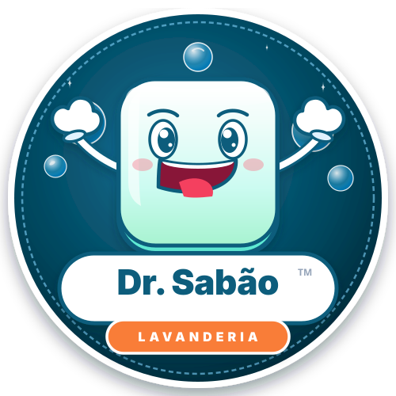
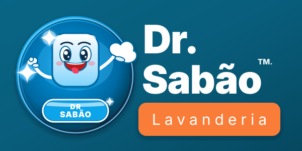

# Lavanderia Dr. Sabão 🫧👕

<p align="center">
  
</p>

<p align="center">
  
  <br />
  <strong>Lavanderia Especializada em Curitiba desde 2011 • Alto da XV</strong>
</p>

---

## 🎨 Identidade Visual e Logos no Repositório

Todas as logos e vetores oficiais estão salvos e versionados dentro da pasta [**`public/`**](./public):

| Arquivo | Descrição | Pré-visualização |
| :--- | :--- | :--- |
| [`public/logo-mascote.svg`](./public/logo-mascote.svg) | Mascote oficial circular do Dr. Sabão com bolhas |  |
| [`public/logo-horizontal.svg`](./public/logo-horizontal.svg) | Logo horizontal oficial para cabeçalhos |  |
| [`public/adesivo-banner.svg`](./public/adesivo-banner.svg) | Adesivo oficial 100x50 (Fachada/Balcão) |  |
| [`public/DrSabao_Logo pequena (1).svg`](./public/DrSabao_Logo%20pequena%20(1).svg) | Vetor original logotipo reduzido | Ícone |
| [`public/DR.SABAO LAVANDERIA - ADESIVO100X50 (8).svg`](./public/DR.SABAO%20LAVANDERIA%20-%20ADESIVO100X50%20(8).svg) | Vetor original adesivo de alta definição | Banner |

---

## 🚀 Como Executar o Projeto Localmente

1. **Instalar dependências**:
   ```bash
   npm install
   ```

2. **Iniciar servidor de desenvolvimento**:
   ```bash
   npm run dev
   ```

3. **Gerar build de produção**:
   ```bash
   npm run build
   ```

---

## 🌐 Publicação no GitHub Pages ou Vercel

- **GitHub Pages**: Configurado via GitHub Actions em [`.github/workflows/deploy.yml`](./.github/workflows/deploy.yml). Ele compila o projeto React/Vite com Node.js 20 e publica automaticamente a pasta `dist`.
- **Vercel / Netlify**: Conecte o repositório diretamente para deploy contínuo em menos de 1 minuto.